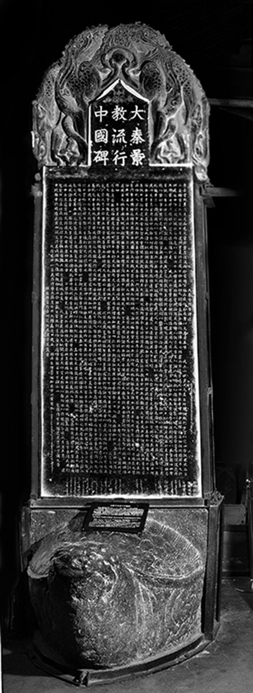

# 附录一　景教碑之一：大略

书中反复出现的那块碑，全名《大秦景教流行中国碑》，今天立在西安碑林博物馆第二展室。小说里的伊斯、景净、宁恕、吕秀岩，碑上都有名字；序章里它出土，第七十五章里它入土，中间这几十年的事，也大半是从这块碑上生发出来的。这一篇讲碑的基本情况和下落；碑文全文与白话译文见附录二，碑上的大施主伊斯见附录三，碑中其他人物见附录四，阿罗本入长安所受的礼遇见附录五。

## 一、碑的大略

碑立于唐德宗建中二年正月初七，公元七八一年。石质为黑色石灰岩，螭首龟趺，通高三百五十余厘米，宽约一米，厚二十余厘米。碑额刻"大秦景教流行中国碑"九个楷书大字，分三行，每行三字；额顶的尖角里，刻着一个立在莲花上的十字，四周饰以云纹。

碑文由大秦寺僧景净撰写，朝议郎、前行台州司士参军吕秀岩书丹，楷书三十二行，满行六十二字，汉字一千七百余。正文之后有颂，颂之后是立碑年月和一长串僧人的名字。碑的下端和左右两侧，另刻有叙利亚文，记的是立碑的年份（希腊纪年一〇九二年，即公元七八一年）、当时在位的牧首，以及七十来位教士的叙利亚名字和职衔，许多人的汉名和叙利亚名并列。

碑文大体分作三层：先讲景教的教义，从创世、人的堕落讲到弥施诃降生、升天；再讲景教入唐一百四十多年的历史，从贞观九年阿罗本到长安，历太宗、高宗、玄宗、肃宗、代宗，一直写到德宗建中年间；最后用一大段文字表彰大施主伊斯，说他跟随郭子仪平叛，"为公爪牙，作军耳目"，又散财修寺，每年聚集四寺僧众，"餧者来而飯之，寒者来而衣之，病者療而起之，死者葬而安之"。

## 二、碑与书中的人

碑上的叙利亚文，替小说里的几个人留下了另一个名字。

伊斯的叙利亚名，学者一般读作耶兹德卜兹（Yazdbōzīd）。碑上说他是京城的司铎和乡主教，已故司铎米利斯之子，来自吐火罗的缚喝城，也就是今天阿富汗北部的巴尔赫。书里伊斯的身世、他父亲米利斯的名字，都从这里来。

景净的叙利亚名叫亚当，碑上称他为司铎、乡主教，兼"中国的教父"（papash of Sinistan）。碑文就是他写的。

碑上叙利亚文题名的牧首，是哈南尼稣二世，汉文碑文末尾"时法主僧宁恕知东方之景众也"一句里的"宁恕"，指的也是他，书中的牧首宁恕就从这里来。他其实在立碑前一年已经去世，提摩太一世已经接任，可这个消息还没有从巴格达传到长安。于是一块碑上，刻着一个已经不在世的牧首的名字。书里第四十九章写的就是这件事。

碑上汉字名单里还有一位"僧景福"。书里第三代的景福，是景净的门生，名字与他相同。

## 三、碑的下落

碑大约在会昌年间禁断外来宗教时被埋入地下，具体年份已不可考。明天启三年（一说天启五年）前后，在西安府城西郊出土，出土经过、李之藻与耶稣会士的考释，详见本书序章。出土后，碑被移到附近的崇仁寺内，建亭保护。清咸丰九年（一八五九年），杭州人韩泰华来访，见碑上字画完好，出资重造碑亭，并在碑侧刻了题记。光绪三十三年（一九〇七年），丹麦人何乐模来西安，想把碑买下运往欧洲，未能如愿，只仿刻了一块复制品运走。同年，陕西地方官府把原碑移入西安碑林，保存至今。

## 四、碑文

碑文全文、校勘说明与白话译文，见附录二《景教碑之二：译文对照》。

---

**版本** v0.2　**最后修改** 2026-11-24 21:21（美国中部时间）　**状态** 修订稿（待作者审定）
